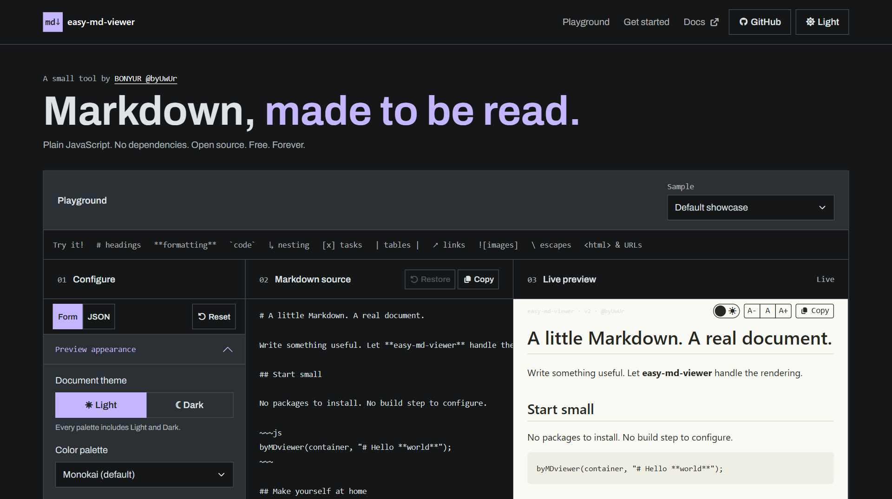

# MD.view

Render Markdown into headings, lists, tables, tasks, links, and code blocks.



## Index

1. [Quick start](#quick-start)
2. [Try it](#try-it)
3. [Downloads](#downloads)
4. [API and options](#api-and-options)
5. [Themes](#themes)
6. [Checks and releases](#checks-and-releases)
7. [Related projects](#related-projects)
8. [License](#license)

## Quick start

```html
<link href="https://cdn.jsdelivr.net/gh/byuwur/md.view@latest/md.min.css" rel="stylesheet" />
<script src="https://cdn.jsdelivr.net/gh/byuwur/md.view@latest/md.min.js" defer></script>

<div id="byMDrenderer" class="light" data-theme="github"></div>
<script>
  document.addEventListener("DOMContentLoaded", () => {
    const markdown = "# My project\n\nRender **Markdown** directly in your page.";
    byMDviewer(document.getElementById("byMDrenderer"), markdown);
  });
</script>
```

Pin a published tag in place of `@latest` for a fixed version. CODE.view adds highlighting for fenced code. Load it before the viewer when you need highlighted output.

### Offline use and Content Security Policy

The renderer loads no remote scripts, fonts, or styles. Code highlighting is optional: host `code.js` and `code.css` locally and load them before rendering; otherwise fences remain plain text. Markdown images need local URLs for offline display. Local library files work without a CDN, including in a `file://` host. Host optional `md.themes.css` locally for extra palettes. The online playground and exported CDN starter still require internet access; a local starter requires all referenced files beside it. Playground fetches and clipboard permissions remain subject to browser restrictions.

Allow the script and style origins in your CSP. Authorize inline initialization and custom theme CSS separately, or move them into local files. The controls use static HTML templates and do not support enforced Trusted Types. Allow Markdown image origins in `img-src`.

## Try it

[Playground](https://md.byuwur.co/) · [CodePen](https://codepen.io/byuwur/pen/VYPoWMM)

The library contains no tracking. The [privacy policy](https://byuwur.co/privacy/dotview) and [cookie policy](https://byuwur.co/cookies/dotview) apply only to the hosted landing page and playground.

Open [index.html](index.html) locally. Its host assets use the network. Exported starters use the default settings.

## Downloads

[ZIP](https://github.com/byuwur/md.view/releases/latest/download/md.view.zip) · [Minified ZIP](https://github.com/byuwur/md.view/releases/latest/download/md.view.minified.zip)

## API and options

The second argument also accepts an `HTMLElement` whose text contains Markdown:

```javascript
const target = document.getElementById("byMDrenderer");
byMDviewer(target, document.getElementById("markdownSource"));
```

Use `byMDviewer(target)` instead when the target itself contains Markdown.

`byMDviewer(target, markdown?, options?)` replaces the target's contents synchronously and returns `undefined`. Invalid targets or source types throw `TypeError`. It has no `ready` promise or controller; call it again to replace the document. Pass the Markdown again on subsequent calls, because the target now contains rendered content.

### Options

Pass options as the third argument, such as `byMDviewer(target, markdown, { breaks: true })`.

| Option              | Default             | Meaning                                                                                                                             |
| ------------------- | ------------------- | ----------------------------------------------------------------------------------------------------------------------------------- |
| `withLinks`         | `true`              | Render links, autolinks, bare URLs, and email addresses.                                                                            |
| `withImages`        | `true`              | Render supported images.                                                                                                            |
| `withTables`        | `true`              | Render GFM-style tables.                                                                                                            |
| `withTasks`         | `true`              | Render task checkboxes.                                                                                                             |
| `withStrikethrough` | `true`              | Render `~~strikethrough~~`.                                                                                                         |
| `codeHighlighting`  | `true`              | Highlight fenced code when CODE.view is loaded; `false` keeps plain code.                                                           |
| `codeLineNumbers`   | `false`             | Show a framed code block with a line-number gutter.                                                                                 |
| `codeStatusBar`     | `false`             | Show a framed code block with its language and line count.                                                                          |
| `breaks`            | `false`             | Convert paragraph line breaks to `<br>`.                                                                                            |
| `headingIdPrefix`   | `""`                | Prefix for heading IDs and matching local Markdown links. Use a different prefix for each document sharing a page.                  |
| `linkTarget`        | `"_blank"`          | Link target; `false` omits it. Same-document anchors stay in this tab.                                                              |
| `animations`        | `true`              | Brief control/disclosure motion and background fades; overrides the system motion preference.                                       |
| `appearAnimation`   | `false`             | Fade the viewer in on each render when `animations` is enabled. Initial rendering remains immediate by default.                     |
| `toolbar`           | `true`              | Show the viewer header; secondary tools are configured separately.                                                                  |
| `credits`           | `true`              | Show attribution in the header.                                                                                                     |
| `theme`             | Container           | Initial `"light"` or `"dark"` mode class.                                                                                           |
| `palette`           | Container or GitHub | Initial `data-theme` palette, including custom CSS names.                                                                           |
| `fontSize`          | Container           | Number in rem or a CSS size such as `"1.25em"` or `"20px"`; bounded to `0.5rem`-`3rem`.                                             |
| `themeToggle`       | `true`              | Show the theme toggle.                                                                                                              |
| `fontSizeControls`  | `true`              | Show text-size controls.                                                                                                            |
| `copyButton`        | `true`              | Show Copy: click for rendered plain text; Shift+click for original Markdown.                                                        |
| `controlsSize`      | `"regular"`         | `"xs"` (0.5rem), `"small"` (0.7rem), `"regular"` (0.875rem), `"large"` (1rem), or `"xl"` (1.25rem); invalid values use `"regular"`. |
| `controlsCompact`   | `true`              | Keep credits beside controls; `false` stacks them. Wraps as needed.                                                                 |
| `controlsPosition`  | `"top"`             | Sticky `"top"` or `"bottom"` toolbar; invalid values use `"top"`.                                                                   |

Plain-text copying preserves paragraph and code line breaks, excluding controls and credits. Copy requires clipboard permission in a secure context.

Read the library version with `byMDviewer.VERSION`.

Controls stick to the selected edge of the page or nearest scrolling container.

The playground disables header-only settings while Viewer header is off, preserving their values. Appearing animation is disabled while Animations is off.

Use `toolbar: false` to hide the header, or disable `credits`, `themeToggle`, `fontSizeControls`, and `copyButton` individually.

Controls use monospace by default; override `--by-view-controls-font` to change it.

### Supported Markdown

Supports ATX headings, emphasis, strikethrough, code spans/fences, ordered/unordered/nested/task lists, recursive blockquotes, horizontal rules, images, links, aligned GFM tables, escapes, and common HTML entities. Task checkboxes are read-only; use [MD.edit](https://github.com/byuwur/md.edit) to edit Markdown. This covers practical documents rather than every CommonMark edge case or extension.

Rendering normalizes CR/LF/CRLF and removes a leading BOM; Shift+Copy retains the original Markdown. Full-document rendering is synchronous and has no document-size limit. Bound large documents in the calling application; the inline parser's limit below does not cap the renderer.

#### Images

Images without size metadata keep their existing dimensions and responsive `max-width: 100%`. Append an optional size comment immediately after an inline image, on the same line:

```markdown

```

Presets are `xs` (96px), `small` (160px), `regular` (320px), `large` (480px), and `xl` (720px). `original` uses the image's natural width. All preserve aspect ratio and shrink to fit the document. Default sizing has no comment; unknown values are ignored. Alt text, URL, and title retain their normal meanings. Code spans and fenced code keep the metadata literal.

The image remains standard Markdown. Other engines supporting HTML comments render it normally and ignore the size hint; engines that escape raw HTML may display the comment. The selected size is specific to renderers supporting this extension.

#### Code blocks

For syntax highlighting, load [CODE.view](https://github.com/byuwur/code.view)'s CSS and JavaScript before rendering Markdown:

```html
<link href="https://cdn.jsdelivr.net/gh/byuwur/code.view@latest/code.min.css" rel="stylesheet" />
<script src="https://cdn.jsdelivr.net/gh/byuwur/code.view@latest/code.min.js" defer></script>
```

Keep the Markdown files too. For offline use, save all four files beside your HTML and use local paths.

Label fences with `js`, `javascript`, or another language supported by the code viewer; aliases work too. Blocks inherit the document's palette, mode, and text size, including High Contrast. Custom palettes can override `--by-code-comment`, `--by-code-keyword`, `--by-code-string`, `--by-code-number`, `--by-code-property`, and `--by-code-tag` on `.byMDdocument`.

Only fenced blocks are enhanced, without extra toolbars. Inline code stays plain. Unknown languages stay uncolored; missing libraries or highlighting limits/errors leave the original code readable. No assets are fetched by the renderer. Loading the library later takes effect on the next render. Set `codeHighlighting: false` to opt out.

Set `codeLineNumbers: true` and `codeStatusBar: true` for the code viewer's compact frame, gutter, and status row. Both are off by default and can be switched independently. They also work with `codeHighlighting: false` for uncolored source. These options use the code viewer's fragment API, without mounting a nested viewer; copy excludes the presentation labels.

```javascript
byMDviewer(document.getElementById("document"), markdown, {
  codeLineNumbers: true,
  codeStatusBar: true
});
```

If highlighting or code-block details are enabled but the library is missing, the first fence logs a console warning with the CODE.view landing link, once per render.

The playground pins its CODE dependency to a numbered release; documentation examples follow `@latest`. Use explicit release tags in deployed pages. Exported starters keep the standalone Markdown setup. Add the two code-viewer files to enable highlighting in a starter.

#### Heading anchors

`## Installation` gets `installation`; repeated headings get suffixes such as `example-1`. Nested headings also receive IDs. Link with `[Installation](#installation)`. With `{ headingIdPrefix: "guide-" }`, both the heading and its local link use `guide-installation`. Links to other page anchors keep their original targets.

#### Links and raw HTML

Links accept relative paths, anchors, and `http`, `https`, `ftp`, `ftps`, `mailto`, or `tel`. Links/images reject executable schemes including `javascript:` and `data:`.

Raw HTML is displayed as text. Comments and document markers such as `[//]: # "OPTIONAL:SECTION"` are hidden except inside code.

#### Source ranges for editing

`byMDviewer.parseInline(source, options = {})` exposes the renderer's inline tokens without creating DOM or changing the source. Token types are `text`, `escape`, `entity`, `code`, `image`, `link`, `strong`, `em`, `strongEm`, and `del`. Every token has `from` and `to`; formatted tokens also provide `bodyFrom`, `bodyTo`, and nested `children` where applicable. Ranges are half-open UTF-16 indexes into the supplied string, matching JavaScript slicing and DOM selections. `withLinks`, `withImages`, and `withStrikethrough` default to `true`, with the renderer's URL checks.

An image with recognized size metadata also has `size` (the preset name) and `sizeFrom` (the comment's starting offset); its `to` includes that comment. Images without metadata retain their existing token shape. `scanLine()` keeps lines with attached image-size metadata visually editable; unrelated comments still use its source fallback.

Non-string source throws `TypeError`; more than 65,536 characters throws `RangeError`. Inline nesting beyond 32 levels stays literal, in both parsing and rendering.

```javascript
const tokens = byMDviewer.parseInline("A **small** document.");
// The strong token covers [2, 11), with its body at [4, 9).
```

`byMDviewer.scanLine(line, context = {}, nextLine = "")` classifies an editing line and returns `type`, `bodyFrom`, `bodyTo`, and `state`. Pass the preceding result's `state` as `context`; `nextLine` enables table-header detection. Fences carry their marker and length; tables expose trimmed cell ranges. Complex nested constructs return `source` so an editor can preserve them literally. This lightweight scanner supports incremental editing; use `byMDviewer()` for complete document rendering.

```javascript
const opening = byMDviewer.scanLine("~~~js");
const code = byMDviewer.scanLine("const answer = 42;", opening.state);
const closing = byMDviewer.scanLine("~~~", code.state);
// Types: fenceOpen, code, fenceClose. closing.state.fence is null.
```

Both line arguments must be strings or `scanLine()` throws `TypeError`. Omit `context` for the first line; otherwise use a preceding scanner result's `state`. Scanning creates no DOM and does not parse the whole document.

[MD.edit](https://github.com/byuwur/md.edit) uses these APIs to keep Markdown as its source of truth and this viewer for exact, read-only Preview.

## Themes

Use `theme` for light or dark mode and `palette` for the color scheme. Monokai, GitHub, Solarized and High Contrast are built in. Load [md.themes.css](md.themes.css) after the base stylesheet for the other palettes.

Options override container settings. Omit an option or pass `null` to keep its current value. Numeric `fontSize` uses rem. CSS sizes such as `20px` also work within the `0.5rem` to `3rem` range. Invalid appearance values throw `RangeError` before replacing the document.

```html
<div id="viewer" class="dark" data-theme="github"></div>
```

Use **Copy CSS** in the playground to export appearance settings. Set `--by-view-document-bg` for the outer background and `--by-view-container-bg` for panels and controls. Define custom palette variables on the component’s mode class and `[data-theme]` selector. For example:

```css
.byMDdocument.dark[data-theme="my-ocean"] {
  --by-view-bg: #102a43;
  --by-view-text: #f0f6fc;
}
```

### Palette names

`monokai`, `github`, `solarized`, `high-contrast`, `dracula`, `darcula`, `nord`, `catppuccin`, `catppuccin-frappe`, `catppuccin-macchiato`, `rose-pine`, `rose-pine-moon`, `gruvbox`, `gruvbox-material`, `tokyo-night`, `tokyo-storm`, `tokyo-moon`, `one`, `material`, `material-ocean`, `night-owl`, `synthwave`, `ayu`, `everforest`, `kanagawa`, `selenized`, `vscode`, `monokai-dimmed`, `discord`, `slack`, `bonyur`, `sakura`, `bubblegum`, `candy`, `rose-gold`, `lavender`, `cyberpunk`, `sunset`, `volcano`, `amber`, `terminal`, `paper`, `ink`, `ocean`, `forest`, `mint`, `ice`, `sepia`.

High Contrast text colors target at least [7:1 contrast](https://www.w3.org/WAI/WCAG22/Understanding/contrast-enhanced.html), with [3:1 contrast for control boundaries and focus cues](https://www.w3.org/WAI/WCAG22/Understanding/non-text-contrast.html). Check contrast again when you override colors.

Legacy integrations can use `#byVIEWtheme` or a detected `md.light.css` / `md.dark.css` link. The toggle keeps its path, query, and hash and updates viewers sharing the link. Explicit container themes stay independent. Separate theme files are no longer shipped; retain your hosted legacy files to use this alternative.

## Checks and releases

Use Node.js 22+ and run these commands from the repository root. For playground checks, place sibling checkouts of `spa.js` at `v20.16`, `code.view` at `v2` next to this repository.

```sh
npm --prefix .github ci --ignore-scripts --no-audit --no-fund
node .github/node_modules/playwright/cli.js install chromium
export NODE_PATH="$PWD/.github/node_modules"
node --test --test-concurrency=1 __tests__/rendering.cjs __tests__/playground.cjs
node .github/scripts/build.mjs --tag v0.0.0-local
npm --prefix .github run release:test
```

In PowerShell, replace the `export` line with `$env:NODE_PATH = "$PWD/.github/node_modules"`. [CI](.github/workflows/rendering.yml) runs Chromium automatically; choose Firefox or WebKit on a manual run.

The [release workflow](.github/workflows/release.yml) tests the regular and minified ZIPs. Both contain the runtime files, README and license. The build manifest records the version and source commit. The local build writes `dist/assets/` and `dist/RELEASE_NOTES.md`. Use `--offline` for local minification. Publish by pushing a version tag matching the library’s `VERSION` (for example, `v2` for version 2).

## Related projects

[CODE.view](https://github.com/byuwur/code.view) · [CSV.view](https://github.com/byuwur/csv.view) · [DIFF.view](https://github.com/byuwur/diff.view) · [JSON.view](https://github.com/byuwur/json.view) · [LOG.view](https://github.com/byuwur/log.view) · [MD.edit](https://github.com/byuwur/md.edit) · [XML.view](https://github.com/byuwur/xml.view) · [YAML.view](https://github.com/byuwur/yaml.view)

## License

[MIT](LICENSE.md) (c) Andres Trujillo [Mateus] byUwUr
