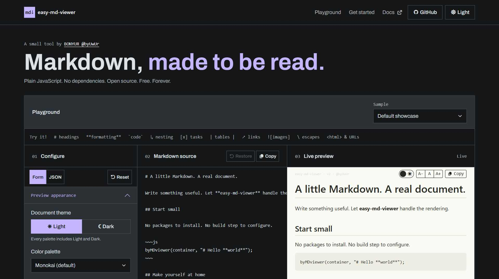

# byuwur/easy-md-viewer



**Markdown, made to be read.**

Render Markdown into headings, lists, tables, tasks, links, and code blocks.

Use it for READMEs, documentation, notes, and other Markdown content.

One JavaScript file. One scoped stylesheet. No build step. Plain JavaScript, with no runtime dependencies.

[Open the playground](https://byuwur.github.io/easy-md-viewer/) · [CodePen](https://codepen.io/byuwur/pen/VYPoWMM)

Open `index.html` for the local playground; its page assets require internet access.

## Installation

**Recommended: CDN.** No downloads or package manager.

```html
<link href="https://cdn.jsdelivr.net/gh/byuwur/easy-md-viewer@latest/md.css" rel="stylesheet" />
<script src="https://cdn.jsdelivr.net/gh/byuwur/easy-md-viewer@latest/md.js" defer></script>
```

The CDN example uses `@latest` and requires internet access. Use a published tag or commit to pin a version.

**Local files:** For offline use, save `md.js` and `md.css` beside your HTML:

```html
<link href="md.css" rel="stylesheet" />
<script src="md.js" defer></script>
```

## Usage

```html
<div id="byMDrenderer" data-theme="light"></div>
<script>
  document.addEventListener("DOMContentLoaded", () => {
    const markdown = "# My project\n\nRender **Markdown** directly in your page.";
    byMDviewer(document.getElementById("byMDrenderer"), markdown);
  });
</script>
```

The second argument also accepts an `HTMLElement` whose text contains Markdown:

```javascript
const target = document.getElementById("byMDrenderer");
byMDviewer(target, document.getElementById("markdownSource"));
```

Use `byMDviewer(target)` instead when the target itself contains Markdown.

`byMDviewer(target, markdown?, options?)` replaces the target's contents synchronously and returns `undefined`. Invalid targets or source types throw `TypeError`. It has no `ready` promise or controller; call it again to replace the document. Pass the Markdown again on subsequent calls, because the target now contains rendered content.

Exported HTML starters use default settings, independently of playground changes.

## Options

Pass options as the third argument, such as `byMDviewer(target, markdown, { breaks: true })`.

| Option              | Default     | Meaning                                                                                                                             |
| ------------------- | ----------- | ----------------------------------------------------------------------------------------------------------------------------------- |
| `withLinks`         | `true`      | Render links, autolinks, bare URLs, and email addresses.                                                                            |
| `withImages`        | `true`      | Render supported images.                                                                                                            |
| `withTables`        | `true`      | Render GFM-style tables.                                                                                                            |
| `withTasks`         | `true`      | Render task checkboxes.                                                                                                             |
| `withStrikethrough` | `true`      | Render `~~strikethrough~~`.                                                                                                         |
| `codeHighlighting`  | `true`      | Highlight fenced code when easy-code-viewer is loaded; `false` keeps plain code.                                                    |
| `codeLineNumbers`   | `false`     | Show a framed code block with a line-number gutter.                                                                                 |
| `codeStatusBar`     | `false`     | Show a framed code block with its language and line count.                                                                          |
| `breaks`            | `false`     | Convert paragraph line breaks to `<br>`.                                                                                            |
| `linkTarget`        | `"_blank"`  | Link target; `false` omits it. Same-document anchors stay in this tab.                                                              |
| `animations`        | `true`      | Brief control/disclosure motion. `true` enables it and `false` disables it, overriding the system motion preference.                |
| `toolbar`           | `true`      | Show the viewer header; secondary tools are configured separately.                                                                  |
| `credits`           | `true`      | Show attribution in the header.                                                                                                     |
| `theme`             | Container   | Initial `"light"` or `"dark"` mode class.                                                                                           |
| `palette`           | Container   | Initial `data-theme` palette, including custom CSS names.                                                                           |
| `fontSize`          | Container   | Number in rem or a CSS size such as `"1.25em"` or `"20px"`; bounded to `0.5rem`–`3rem`.                                             |
| `themeToggle`       | `true`      | Show the theme toggle.                                                                                                              |
| `fontSizeControls`  | `true`      | Show text-size controls.                                                                                                            |
| `copyButton`        | `true`      | Show Copy: click for rendered plain text; Shift+click for original Markdown.                                                        |
| `controlsSize`      | `"regular"` | `"xs"` (0.5rem), `"small"` (0.7rem), `"regular"` (0.875rem), `"large"` (1rem), or `"xl"` (1.25rem); invalid values use `"regular"`. |
| `controlsCompact`   | `true`      | Keep credits beside controls; `false` stacks them. Wraps as needed.                                                                 |
| `controlsPosition`  | `"top"`     | Sticky `"top"` or `"bottom"` toolbar; invalid values use `"top"`.                                                                   |

Plain-text copying preserves paragraph and code line breaks, excluding controls and credits. Copy requires clipboard permission in a secure context.

Read the library version with `byMDviewer.VERSION`.

Controls stick to the selected edge of the page or nearest scrolling container.

Use `toolbar: false` to hide the header, or disable `credits`, `themeToggle`, `fontSizeControls`, and `copyButton` individually.

Controls use monospace by default; override `--by-view-controls-font` to change it.

## Themes

Configure appearance in the options object or on the container:

```javascript
byMDviewer(target, markdown, {
  theme: "dark",
  palette: "github",
  fontSize: 1.125
});
```

`theme` sets the mode class; `palette` sets `data-theme`. `fontSize` numbers use rem (`1` = the root text size); CSS sizes such as `"1.25em"`, `"1.25rem"`, and `"20px"` are also accepted. All sizes stay between `0.5rem` and `3rem`. Explicit options override markup; omitted or `null` values retain the container's settings. A named palette preserves its existing mode, including the `data-theme="light"` / `"dark"` aliases. Invalid appearance values throw `RangeError` before replacing the current document. Text-size Reset returns to the configured size, including after re-rendering.

Initial content appears immediately. Animations affect controls and deliberate show/hide actions; rows, tokens, and typing are not animated. Disclosure size/exit transitions progressively enhance browsers that support them.

The outer document and inner surfaces have independent CSS backgrounds. Both follow the selected theme unless overridden. Set `--by-view-document-bg: #0000` to reveal the host page while keeping content panels and individual controls readable. `--by-view-container-bg` sets the shared background of those panels and controls; it also accepts alpha colors or `transparent`. The toolbar and credits have no background. These overrides survive theme changes.

```css
.byMDdocument {
  --by-view-document-bg: #0000;
}
```

The playground uses SPA.js's Pickr assets for color and opacity, with text inputs when Pickr is unavailable. **Copy CSS** exports the appearance overrides; clear a field to restore its theme default. The renderer needs no color-picker dependency.

**48 palettes, each with Light and Dark modes.** Monokai, GitHub, Solarized, and High Contrast are included in `md.css`. Load the optional `md.themes.css` after it for the other 44 skins:

```html
<link rel="stylesheet" href="https://cdn.jsdelivr.net/gh/byuwur/easy-md-viewer@latest/md.themes.css" />
```

For local use, save `md.themes.css` beside `md.css`. The playground loads both stylesheets; default HTML starters use the core stylesheet. Known extra presets without the pack fall back to the current mode and emit a one-time `console.warn` naming the required file. Custom CSS names do not need the pack.

The picker groups palettes into Essentials, Editor classics, App inspired, Colorful, and Reading & nature. Palette definitions remain at the end of each stylesheet.

| Palette | `data-theme` | What it looks like |
| --- | --- | --- |
| Monokai (default) | `monokai` | Warm light and dark colors; the default. |
| GitHub | `github` | Neutral GitHub surfaces and syntax. |
| Solarized | `solarized` | Warm paper and deep blue-green surfaces. |
| High Contrast | `high-contrast` | Strong text, borders, and focus indicators. |
| Dracula | `dracula` | Purple with vivid pink, green, and cyan. |
| Darcula | `darcula` | Charcoal surfaces and warm IDE accents. |
| Nord | `nord` | Arctic blues and snowy neutral surfaces. |
| Catppuccin | `catppuccin` | Latte and Mocha with soft mauve accents. |
| Catppuccin Frappé | `catppuccin-frappe` | Cooler Catppuccin with a blue accent. |
| Catppuccin Macchiato | `catppuccin-macchiato` | Catppuccin with a warm pink accent. |
| Rosé Pine | `rose-pine` | Dawn and Pine with dusty rose accents. |
| Rosé Pine Moon | `rose-pine-moon` | A duskier violet take on Rosé Pine. |
| Gruvbox | `gruvbox` | Warm retro browns, olive, and orange. |
| Gruvbox Material | `gruvbox-material` | Softer earthy surfaces and muted greens. |
| Tokyo Night | `tokyo-night` | Tokyo Day and Night with electric blues. |
| Tokyo Storm | `tokyo-storm` | A brighter blue-gray Tokyo evening. |
| Tokyo Moon | `tokyo-moon` | Indigo nights and luminous lavender. |
| One | `one` | Clean One Light and One Dark colors. |
| Material | `material` | Blue-gray material surfaces and cyan. |
| Material Ocean | `material-ocean` | Deep navy with soft fluorescent accents. |
| Night Owl | `night-owl` | Little Light and deep-blue night colors. |
| Synthwave | `synthwave` | Neon magenta and cyan with no glow effects. |
| Ayu | `ayu` | Warm amber over light paper or dark navy. |
| Everforest | `everforest` | Soft forest greens and cream. |
| Kanagawa | `kanagawa` | Ink, old paper, and Japanese wave colors. |
| Selenized | `selenized` | Balanced teal surfaces and restrained color. |
| VS Code | `vscode` | Familiar neutral editor surfaces and blue. |
| Monokai Dimmed | `monokai-dimmed` | Quieter charcoal and desaturated Monokai. |
| Discord | `discord` | Blurple accents and familiar chat surfaces. |
| Slack | `slack` | Aubergine, warm pink, and friendly teal. |
| BONYUR | `bonyur` | Signature teal and pink over warm neutral ink. |
| Sakura | `sakura` | Cherry-blossom pink from surface to syntax. |
| Bubblegum | `bubblegum` | Saturated hot-pink surfaces and cyan accents. |
| Candy | `candy` | Pink and mint with playful lavender syntax. |
| Rose Gold | `rose-gold` | Dusty pink and warm copper. |
| Lavender | `lavender` | Lilac surfaces with deep violet accents. |
| Cyberpunk | `cyberpunk` | Acid yellow, electric cyan, and magenta. |
| Sunset | `sunset` | Burnt orange, coral, and evening purple. |
| Volcano | `volcano` | Lava reds over warm ash. |
| Amber | `amber` | Golden amber inspired by old displays. |
| Terminal | `terminal` | Phosphor greens on near-black. |
| Paper | `paper` | Warm cream, brown ink, and quiet margins. |
| Ink | `ink` | Grayscale surfaces and restrained syntax. |
| Ocean | `ocean` | Deep ocean blue and clear turquoise. |
| Forest | `forest` | Rich green surfaces and mossy accents. |
| Mint | `mint` | Fresh mint surfaces and cool teal. |
| Ice | `ice` | Glacial blue, crisp whites, and silver. |
| Sepia | `sepia` | Aged parchment and warm brown ink. |

Editor and app skins are inspired adaptations, including light counterparts where needed; colors are adjusted for readable text and controls rather than exact replicas. All palettes use the same layout and need no assets beyond the core stylesheet and optional theme pack.

Use a mode class and a palette name together:

```html
<div id="viewer" class="dark" data-theme="github"></div>
<!-- High Contrast Light: class="light" data-theme="high-contrast" -->
<!-- High Contrast Dark: class="dark" data-theme="high-contrast" -->
```

Rendering adds `.byMDdocument`; its variables affect only that container and its children. The theme switch changes mode while keeping the palette; re-rendering preserves both. A named palette without a mode class starts in Light; if both mode classes are present, Dark wins.

`data-theme="light"` and `data-theme="dark"` select Monokai and override mode classes. A mode class alone, or no explicit theme, also uses Monokai.

### High Contrast

High Contrast text colors target at least [7:1 contrast](https://www.w3.org/WAI/WCAG22/Understanding/contrast-enhanced.html), with [3:1 contrast for control boundaries and focus cues](https://www.w3.org/WAI/WCAG22/Understanding/non-text-contrast.html). Check contrast again when you override colors.

### Make it yours

The playground's **Custom theme CSS** field edits both modes of the selected palette. Export those rules to your own stylesheet and use `data-theme="custom"` with `class="light"` or `class="dark"`. Custom drafts stay in the playground; the renderer does not store them.

Define a named palette after the viewer stylesheet. Unspecified colors inherit Monokai:

```css
.byMDdocument.light[data-theme="my-ocean"] {
  --by-md-bg: #f3f8fc;
  --by-md-text: #102a43;
  --by-md-border: #486581;
  --by-md-link: #005a9c;
}

.byMDdocument.dark[data-theme="my-ocean"] {
  --by-md-bg: #102a43;
  --by-md-text: #f0f6fc;
  --by-md-border: #9fb3c8;
  --by-md-link: #8cd3ff;
}
```

```html
<div id="viewer" class="dark" data-theme="my-ocean"></div>
```

Named palettes need no JavaScript registration or extra theme files.

In the playground configuration, `theme` is the mode, `palette` is its name, and `customThemeCSS` holds custom rules. Null appearance values inherit defaults. Pass only documented API options to the renderer.

**Copy CSS** exports typography and individual color overrides. Inline colors override palette variables; clear them or Reset to restore palette defaults.

Text-size controls change only this viewer, in `0.125rem` steps from `0.5rem` to `3rem`, independently of button size. **A** restores its initial size; re-rendering preserves the selected size.

### Legacy theme links

Legacy integrations can use `#byVIEWtheme` or a detected `md.light.css` / `md.dark.css` link. The toggle keeps its path, query, and hash and updates viewers sharing the link. Explicit container themes stay independent. Separate theme files are no longer shipped; retain your hosted legacy files to use this alternative.

## Supported Markdown

Supports ATX headings, emphasis, strikethrough, code spans/fences, ordered/unordered/nested/task lists, recursive blockquotes, horizontal rules, images, links, aligned GFM tables, escapes, and common HTML entities. Task checkboxes are read-only; use [easy-md-editor](https://github.com/byuwur/easy-md-editor) to edit Markdown. This covers practical documents rather than every CommonMark edge case or extension.

Rendering normalizes CR/LF/CRLF and removes a leading BOM; Shift+Copy retains the original Markdown. Full-document rendering is synchronous and has no document-size limit. Bound large documents in the calling application; the inline parser's limit below does not cap the renderer.

### Code blocks

For syntax highlighting, load [easy-code-viewer](https://github.com/byuwur/easy-code-viewer)'s CSS and JavaScript before rendering Markdown:

```html
<link href="https://cdn.jsdelivr.net/gh/byuwur/easy-code-viewer@latest/code.css" rel="stylesheet" />
<script src="https://cdn.jsdelivr.net/gh/byuwur/easy-code-viewer@latest/code.js" defer></script>
```

Keep the Markdown files too. For offline use, save all four files beside your HTML and use local paths.

Label fences with `js`, `javascript`, or another language supported by the code viewer; aliases work too. Blocks inherit the document's palette, mode, and text size, including High Contrast. Custom palettes can override `--by-code-comment`, `--by-code-keyword`, `--by-code-string`, `--by-code-number`, `--by-code-property`, and `--by-code-tag` on `.byMDdocument`.

Only fenced blocks are enhanced, without extra toolbars. Inline code stays plain. Unknown languages stay uncolored; missing libraries or highlighting limits/errors leave the original code readable. No assets are fetched by the renderer. Loading the library later takes effect on the next render. Set `codeHighlighting: false` to opt out.

Set `codeLineNumbers: true` and `codeStatusBar: true` for the code viewer's compact frame, gutter, and status row. Both are off by default and can be switched independently. They also work with `codeHighlighting: false` for uncolored source. These options use the code viewer's fragment API, without mounting a nested viewer; copy excludes the presentation labels.

```javascript
byMDviewer(document.getElementById("document"), markdown, {
  codeLineNumbers: true,
  codeStatusBar: true
});
```

If highlighting or code-block details are enabled but the library is missing, the first fence logs a console warning with the easy-code-viewer landing link, once per render.

The playground pins its CODE dependency to a numbered release; documentation examples follow `@latest`. Use explicit release tags in deployed pages. Exported starters keep the standalone Markdown setup. Add the two code-viewer files to enable highlighting in a starter.

### Heading anchors

`## Installation` gets `installation`; repeated headings get suffixes such as `example-1`. Nested headings also receive IDs. Link with `[Installation](#installation)`.

### Links and raw HTML

Links accept relative paths, anchors, and `http`, `https`, `ftp`, `ftps`, `mailto`, or `tel`. Links/images reject executable schemes including `javascript:` and `data:`.

Raw HTML is displayed as text. Comments and document markers such as `[//]: # "OPTIONAL:SECTION"` are hidden except inside code.

### Source ranges for editing

`byMDviewer.parseInline(source, options = {})` exposes the renderer's inline tokens without creating DOM or changing the source. Token types are `text`, `escape`, `entity`, `code`, `image`, `link`, `strong`, `em`, `strongEm`, and `del`. Every token has `from` and `to`; formatted tokens also provide `bodyFrom`, `bodyTo`, and nested `children` where applicable. Ranges are half-open UTF-16 indexes into the supplied string, matching JavaScript slicing and DOM selections. `withLinks`, `withImages`, and `withStrikethrough` default to `true`, with the renderer's URL checks.

Non-string source throws `TypeError`; more than 65,536 characters throws `RangeError`. Inline nesting beyond 32 levels stays literal, in both parsing and rendering.

```javascript
const tokens = byMDviewer.parseInline("A **small** document.");
// The strong token covers [2, 11), with its body at [4, 9).
```

`byMDviewer.scanLine(line, context = {}, nextLine = "")` classifies an editing line and returns `type`, `bodyFrom`, `bodyTo`, and `state`. Pass the preceding result's `state` as `context`; `nextLine` enables table-header detection. Fences carry their marker and length; tables expose trimmed cell ranges. Complex nested constructs return `source` so an editor can preserve them literally. This lightweight scanner supports incremental editing; use `byMDviewer()` for complete document rendering.

```javascript
const opening = byMDviewer.scanLine("~~~js");
const code = byMDviewer.scanLine("const answer = 42;", opening.state);
const closing = byMDviewer.scanLine("~~~", code.state);
// Types: fenceOpen, code, fenceClose. closing.state.fence is null.
```

Both line arguments must be strings or `scanLine()` throws `TypeError`. Omit `context` for the first line; otherwise use a preceding scanner result's `state`. Scanning creates no DOM and does not parse the whole document.

[easy-md-editor](https://github.com/byuwur/easy-md-editor) uses these APIs to keep Markdown as its source of truth and this viewer for exact, read-only Preview.

## Checks

Theme tests cover both modes, container isolation, legacy links, custom CSS, and High Contrast. Integration tests use the actual code viewer; check out `easy-code-viewer` beside this repository before running the full suite.

Playground tests fetch the pinned Bootstrap stylesheet unless `BOOTSTRAP_CSS_PATH` points to a cached copy.

Install Playwright outside the repository and set `NODE_PATH` to its `node_modules` directory:

```sh
node --check md.js
node --test tests/rendering.cjs   # Library
node --test tests/playground.cjs  # Playground
```

`CHROMIUM_EXECUTABLE_PATH` selects a Chromium executable for every test. Otherwise, install Playwright Chromium; `BROWSER_CHANNEL=chrome` applies only to the suites that support it.

[GitHub Actions](.github/workflows/rendering.yml) reports Library and Playground as independent jobs; a failed suite does not cancel the other. Library checks load the renderer directly; playground checks cover the landing page, configuration, and exports.

## The easy viewers

Need another format, or a Markdown editor? Explore the family:

[Markdown](https://github.com/byuwur/easy-md-viewer) · [JSON](https://github.com/byuwur/easy-json-viewer) · [CSV & TSV](https://github.com/byuwur/easy-csv-viewer) · [Logs](https://github.com/byuwur/easy-log-viewer) · [Diff](https://github.com/byuwur/easy-diff-viewer) · [XML](https://github.com/byuwur/easy-xml-viewer) · [YAML](https://github.com/byuwur/easy-yaml-viewer) · [Source code](https://github.com/byuwur/easy-code-viewer)

[Write Markdown with easy-md-editor](https://github.com/byuwur/easy-md-editor).

## License

MIT (c) Andres Trujillo [Mateus] byUwUr
