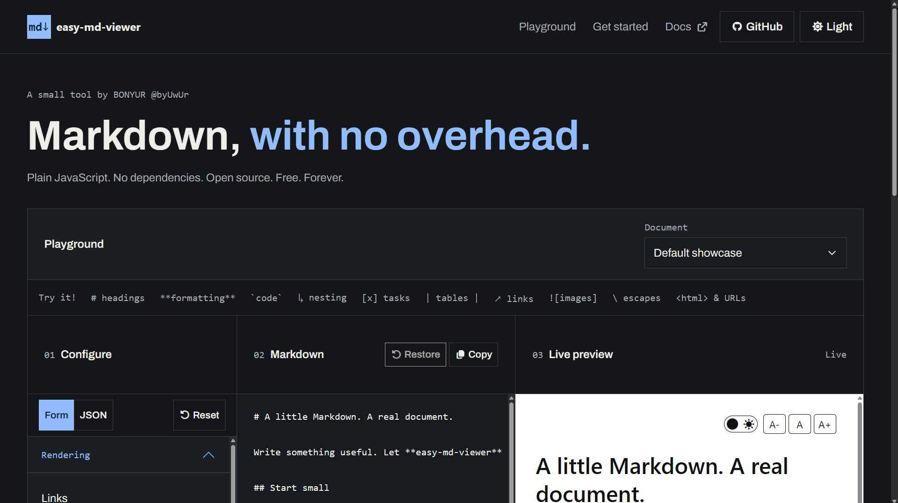

# byuwur/easy-md-viewer



Render Markdown with light/dark themes and text-size controls. Plain JavaScript; no dependencies or build step.

Try [GitHub Pages](https://byuwur.github.io/easy-md-viewer/) or [CodePen](https://codepen.io/byuwur/pen/VYPoWMM).

## Installation

```html
<link href="https://cdn.jsdelivr.net/gh/byuwur/easy-md-viewer@v1.8/md.min.css" rel="stylesheet" />
<link id="byVIEWtheme" href="https://cdn.jsdelivr.net/gh/byuwur/easy-md-viewer@v1.8/md.light.css" rel="stylesheet" />
<script src="https://cdn.jsdelivr.net/gh/byuwur/easy-md-viewer@v1.8/md.min.js" defer></script>
```

For local use, save `md.js`, `md.css`, and `md.light.css` beside your HTML and use those paths. Omit the CDN version only when testing development changes; pinned URLs need a new release to receive fixes.

## Usage

After the installation above:

```html
<div id="byMDrenderer"></div>
<script>
  document.addEventListener("DOMContentLoaded", () => {
    const markdown = "# My project\n\nRender **Markdown** directly in your page.";
    byMDviewer(document.getElementById("byMDrenderer"), markdown);
  });
</script>
```

The target and library must exist before calling the viewer; `DOMContentLoaded` waits for the deferred library.

The second argument also accepts an `HTMLElement` whose text contains Markdown:

```javascript
const target = document.getElementById("byMDrenderer");
byMDviewer(target, document.getElementById("markdownSource"));
```

Use `byMDviewer(target)` instead when the target itself contains Markdown.

The landing page's **Copy HTML** and **Download HTML** use its displayed starter and default settings, independently of the playground. CDN/local tabs also control those exports; CDN files need internet, local files must stay beside the saved HTML.

## Options

Pass options as the third argument, such as `byMDviewer(target, markdown, { breaks: true })`.

| Option              | Default     | Meaning                                                                            |
| ------------------- | ----------- | ---------------------------------------------------------------------------------- |
| `withLinks`         | `true`      | Render links, autolinks, bare URLs, and email addresses.                           |
| `withImages`        | `true`      | Render supported images.                                                           |
| `withTables`        | `true`      | Render GFM-style tables.                                                           |
| `withTasks`         | `true`      | Render task checkboxes.                                                            |
| `withStrikethrough` | `true`      | Render `~~strikethrough~~`.                                                        |
| `breaks`            | `false`     | Convert paragraph line breaks to `<br>`.                                           |
| `linkTarget`        | `"_blank"`  | Link target; `false` omits it. Same-document anchors stay in this tab.             |
| `themeToggle`       | `true`      | Show a toggle when a compatible stylesheet exists.                                 |
| `fontSizeControls`  | `true`      | Show A-/A+ controls.                                                               |
| `copyButton`        | `true`      | Show Copy: click for rendered plain text; Shift+click for original Markdown.       |
| `controlsSize`      | `"regular"` | Button size: `"small"`, `"regular"`, or `"large"`; invalid values use `"regular"`. |
| `controlsCompact`   | `false`     | Put attribution beside the controls, wrapping when space is limited.               |
| `controlsPosition`  | `"top"`     | Toolbar position: `"top"` or `"bottom"`; invalid values use `"top"`.               |

Plain-text copying preserves paragraph and code line breaks and excludes viewer controls and attribution. Shift+click copies the source, including Markdown markers. Copy requires browser clipboard access in a secure context; the button reports failure if access is unavailable or denied.

Each toolbar shows a GitHub link, version, and author portfolio link in a muted theme color. Read the library version with `byMDviewer.VERSION`.

Controls stay visible at the selected edge of the page or nearest scrolling container while the viewer is in view. Their opaque background follows the viewer theme. Bottom toolbars put credits below the buttons when stacked. For a compact header, use `{ controlsSize: "small", controlsCompact: true, controlsPosition: "top" }`. Button size is independent of the document text size.

## Themes

`md.css` contains the styling rules and light defaults. Theme files only override CSS variables on `.byMDdocument`.

The toggle uses a compatible `#byVIEWtheme` or finds a stylesheet named `md.light.css`/`md.dark.css`, preserving its path, query, and hash. Theme changes apply to all Markdown viewers using that stylesheet. Switch that stylesheet manually to select a theme.

A-/A+ adjust only this viewer by `0.125rem`, within `0.5rem`–`3rem`. Size survives re-rendering and works without a theme stylesheet.

## Supported Markdown

Supports ATX headings, emphasis, strikethrough, code spans/fences, ordered/unordered/nested/task lists, recursive blockquotes, horizontal rules, images, links, aligned GFM tables, escapes, and common HTML entities. Task checkboxes are disabled. This covers practical documents rather than every CommonMark edge case or extension.

### Heading anchors

`## Installation` gets `installation`; repeated headings get suffixes such as `example-1`. Nested headings also receive IDs. Link with `[Installation](#installation)`.

### Links and raw HTML

Links accept relative paths, anchors, and `http`, `https`, `ftp`, `ftps`, `mailto`, or `tel`. Links/images reject executable schemes including `javascript:` and `data:`.

Raw HTML is displayed as text. Comments and document markers such as `[//]: # "OPTIONAL:SECTION"` are hidden except inside code.

## Checks

[GitHub Actions](.github/workflows/rendering.yml) runs `tests/rendering.cjs` against local `md.js` in Chromium, including the benchmark and playground exports. For visual checks, serve `index.html` over HTTP and select `test.md` from the Document menu.

## License

MIT (c) Andres Trujillo [Mateus] byUwUr
